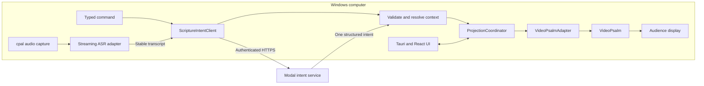

# Architecture

The model interprets language. **Rust decides what may execute.** Model output never becomes arbitrary keystrokes, shell commands, selectors, or mouse coordinates.



## Ownership

| Component | Responsibility |
| --- | --- |
| `AppOrchestrator` / `SessionManager` | Start/stop services, propagate cancellation, publish state |
| `AudioCaptureService` | Enumerate devices, capture frames, meter input, bounded buffering |
| `SpeechRecognitionService` | Stream partial/stable/final segments with timestamps |
| `ScriptureIntentClient` | Authenticated asynchronous requests, deadlines, stale-response rejection |
| `ScriptureSession` | Current passage/translation, last projected passage, history, deduplication |
| `ScriptureNavigator` | Resolve next/previous verse and ranges using canonical metadata |
| `TranslationResolver` | Map recognized names to verified installed VideoPsalm translations |
| `VerseSearchService` | Search a licensed corpus for quotes; return ranked references for review |
| `ProjectionCoordinator` | Validate intents, enforce modes, serialize projection, report results |
| `VideoPsalmAdapter` | Discover/bind controls, search/select, preview/present, observe status |
| `SettingsStore` | Local configuration, Credential Manager access, diagnostic policy |
| React UI | Operator controls and state display through Tauri commands/events |
| Modal service | Inference only; no desktop or VideoPsalm access |

## Modules

```text
src-tauri/src/
  app/          # orchestration, sessions, Tauri commands/events
  audio/        # cpal capture and streaming ASR adapter
  intent/       # Modal HTTP client, wire types, validation
  scripture/    # session, navigation, translations, quote lookup
  projection/   # coordinator, Windows adapter, automation profiles
  settings/     # persistence, credentials, diagnostics
src/            # React/TypeScript UI
inference-modal/# Python service, prompts, model/serving configuration
tests/fixtures/ # labeled utterances, expected intents, adapter traces
```

This is the proposed **application repository** layout, separate from this MkDocs repository.

## Concurrency and cancellation

- Capture callbacks enqueue bounded frames; they do not run ASR, HTTP, or automation.
- ASR publishes revisions for display. Only sufficiently stable segments enter inference; unstable partial text never projects.
- Debounce revisions and use a bounded latest-relevant inference queue. Reuse one HTTP client/connection pool.
- Each session has a cancellation generation. Track request IDs and transcript order; discard responses from an old session, superseded segment, or expired deadline.
- Run blocking Windows automation on one dedicated, COM-initialized worker. Never block the UI thread or perform competing focus operations.
- Serialize VideoPsalm transactions. A newer command supersedes older **unexecuted automatic** commands; cancellation does not undo input already sent.
- On overflow or excessive lag, discard obsolete work, pause Automatic mode, and show the reason. Buffer sizes, timeouts, and debounce intervals need benchmark-based defaults.

## Session state

`ScriptureSession` holds `current_reference`, `current_translation`, `last_projected_reference`, `last_intent_id`, and bounded history. Keep detected/approved passages distinct from a confirmed live projection. Track context age and its origin so relative commands cannot silently use stale or ambiguous context.

Deduplicate the resolved action/reference/range/translation tuple. A sent-but-unverified command can already be live, so suppress its duplicates too. An operator-requested repeat is explicit.

## Lifecycle

```text
Disconnected → Connected → Listening → Interpreting → Candidate
Candidate → WaitingApproval → Preparing → Presenting → Result
Candidate → Preparing                       # eligible Automatic only
Any active stage → Stopped / RecoverableError
```

Stopped means capture and future automation are canceled. It does **not** mean VideoPsalm's audience display has been blanked or frozen. A hung native call may outlast a Rust deadline; define a worker recovery strategy rather than promising that every call is interruptible.
